# Alif Ensemble E8 Image Pipeline Workshop

This hands-on workshop walks you through building a camera image pipeline on the **Alif Ensemble E8** using the **AppKit-E8** board and the **Cortex-M55 High-Efficiency (HE)** core. You will work in **VS Code** with the **CMSIS csolution** extensions.

Each section builds on the previous one:

| Section | Topic | Output |
| --- | --- | --- |
| [Section 0](#section-0--environment-setup) | Environment setup and toolchain check | Running "hello world" application |
| [Section 1](#section-1--capturing-a-raw-camera-image) | Camera capture over MIPI CSI-2 | Raw Bayer image |
| [Section 2](#section-2--processing-the-image-with-the-isp) | Image Signal Processor (ISP) | NV12 (YUV 4:2:0) color image |
| [Section 3](#section-3--jpeg-encoding) | Hardware JPEG encoder | JPEG file |

## Prerequisites

- [ ] AppKit-E8 board with the OV5675 camera module connected
- [ ] USB cable for debug and serial connection
- [ ] VS Code with the CMSIS csolution extensions and the Alif toolchain installed
- [ ] A serial terminal application
- [ ] A web browser

## Conventions

- **Bold** marks things you see in the VS Code UI: tabs, buttons, menu entries, and driver entries or settings in the configuration view.
- `Monospace` marks software component paths, file names, and commands you type.
- **Why?** notes explain the reasoning behind a configuration choice. You can skip them and still complete the steps.

---

## Section 0 – Environment Setup

In this section you clone the starting project, build it, and run it on the board to confirm that the toolchain and debugger are working.

1. Clone the workshop repository:
   ```sh
    git clone git@github.com:alifsemi/alif_imagepipeline-training.git
   ```
2. Open the cloned folder in VS Code. When prompted, allow the extensions to run **for the current workspace**.
3. Initialize the Git submodules:
   ```sh
    git submodule update --init
   ```
4. Open the **CMSIS** tab, then open the solution:
   1. Make sure **AppKit-E8-HE** is selected as the target.
   2. In the project list, make sure **image_pipeline** is selected with the **debug** build type and the **image+symbols** load setting.
   3. Uncheck **Update launch.json and tasks.json**.

      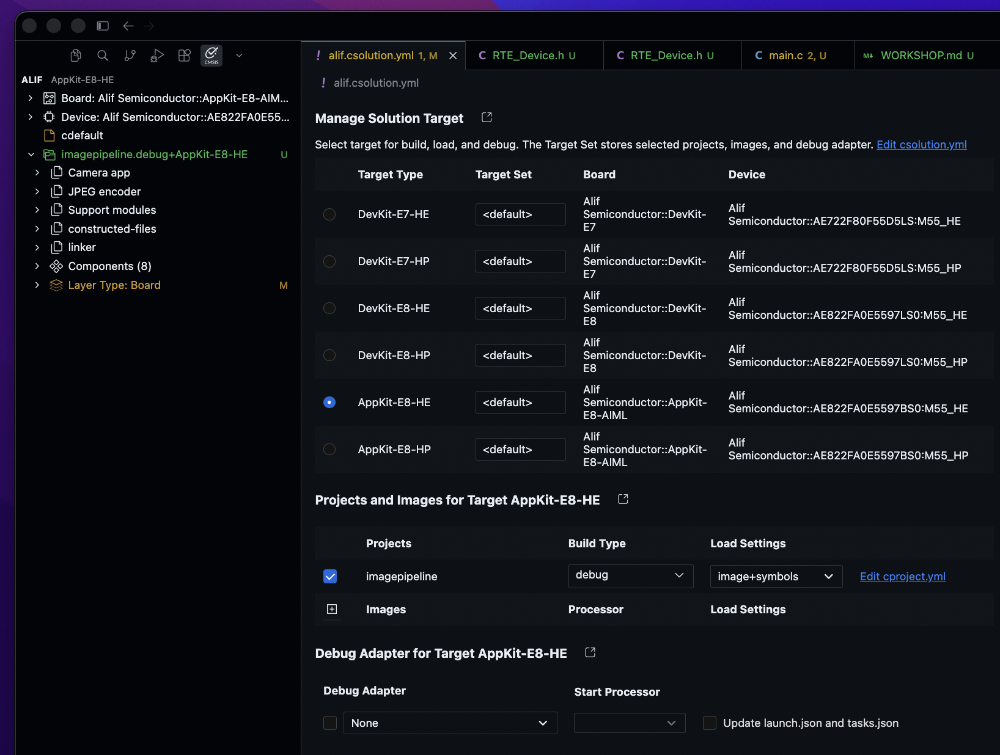

      > **Why?** The **image+symbols** setting makes the debugger flash the application and also load its debug symbols, so you can set breakpoints and inspect variables. **Update launch.json and tasks.json** is unchecked because the repository already contains debug and build configurations prepared for this board. Letting the extension regenerate them would overwrite those settings.

5. Build the project to verify that the toolchain is set up correctly.
6. Set the board's UART selection to **UART2 (U2)** and open a serial terminal at **115200 baud**.

   > **Why?** The application prints its status messages on UART2. The selection routes UART2 to the board's USB serial port so the messages appear on your computer.

7. Return to VS Code and open the **Run and Debug** tab:
   1. Select **Alif Ensemble Debug (Cortex-Debug)** from the drop-down.
   2. Press the **Play** button to start the debug session.
   3. The application is flashed and execution stops at the first line of `main()`.
   4. Press **Continue** (the play button in the debug toolbar at the top) to resume execution.

      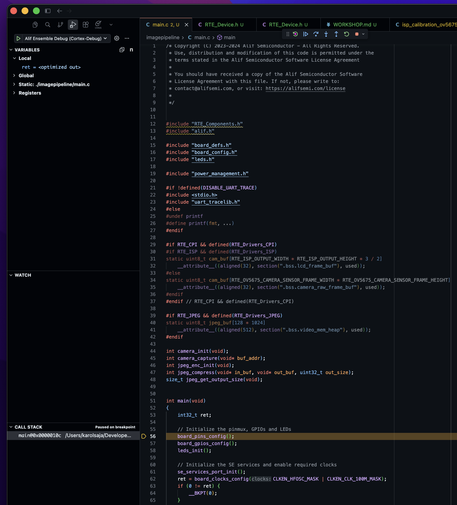
8. Check the serial terminal output to confirm that the application runs to completion.

   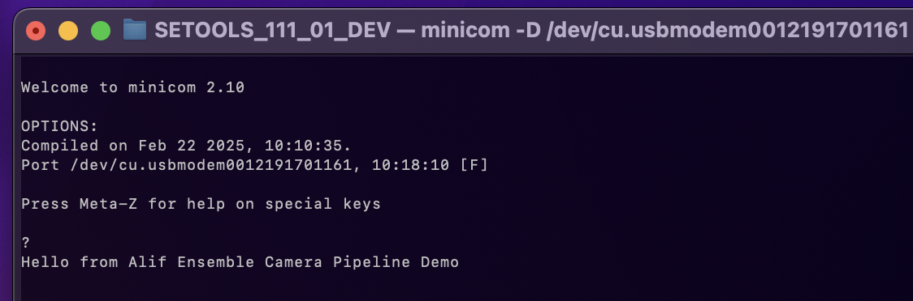
9. Press **Stop** to end the debug session and disconnect the debugger from the device.

---

## Section 1 – Capturing a Raw Camera Image

In this section you add the camera drivers to the project, configure the capture path, and grab a raw frame from the SoC memory.

### Add the software components

1. In the **CMSIS** tab, open the **Manage Software Components** view.
2. Select the following components:
   | Component | Notes |
    | --- | --- |
    | `BSP → External Peripherals → CAMERA Sensor OV5675` | Sensor driver |
    | `CMSIS Driver → I2C (API) → I2C` | Vendor: **AlifSemiconductor** |
    | `Device → SOC Peripherals → CPI` | Camera Pixel Interface |
    | `Device → SOC Peripherals → GPIO` | |
    | `Device → SOC Peripherals → MIPI CSI2` | |
    | `Device → SOC Peripherals → MIPI DSI CSI2 DPHY` | |
    | `Device → SOC Peripherals → PINCONF` | |
   > **Note:** The starting project already has some components selected. Leave them selected.

    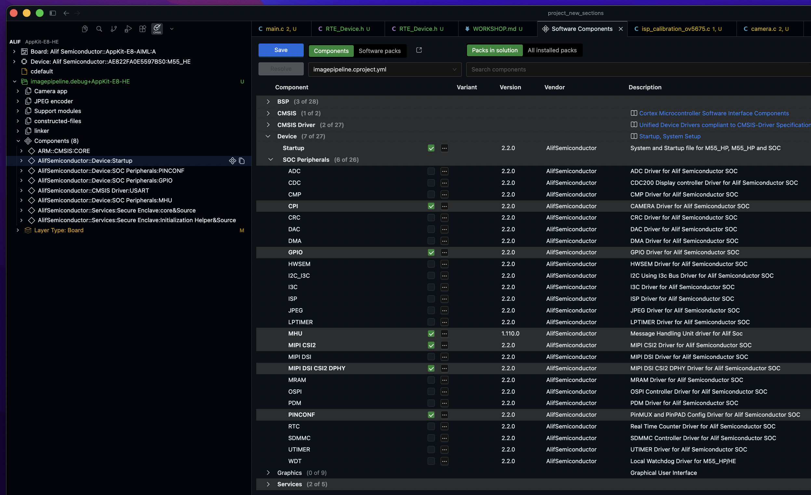
   > **Why?** These components make up the camera receive path. The OV5675 sends image data to the SoC over a MIPI CSI-2 link. The **MIPI DSI CSI2 DPHY** driver handles the physical layer of that link, and the **MIPI CSI2** driver decodes the CSI-2 packets. The **CPI** (Camera Pixel Interface) driver takes the decoded pixels and writes them to memory. The sensor itself is configured over **I2C**, and **GPIO** and **PINCONF** control the sensor's power and reset pins and the pin multiplexing.
3. Press **Save** (top left) to apply the configuration and add the drivers to the project.
4. Close the **Manage Software Components** view and return to the **CMSIS** tab.

### Configure the drivers

5. Expand the project, then **Components** → `AlifSemiconductor::Device:Startup`, and double-click `RTE_Device.h` to open the driver configuration.

   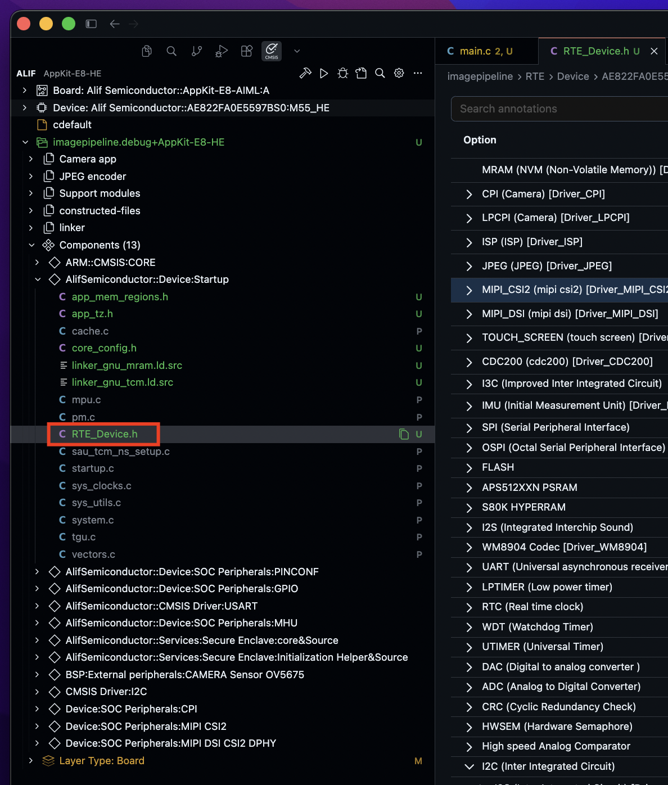
6. Enable **CPI (Camera) [Driver_CPI]**, expand it, and check the following settings:
   | Setting | Value |
    | --- | --- |
    | Select CPI AXI port | Enable |
    | Select CPI ISP port | Disable |
    | Enable CPI streaming | Disable |

    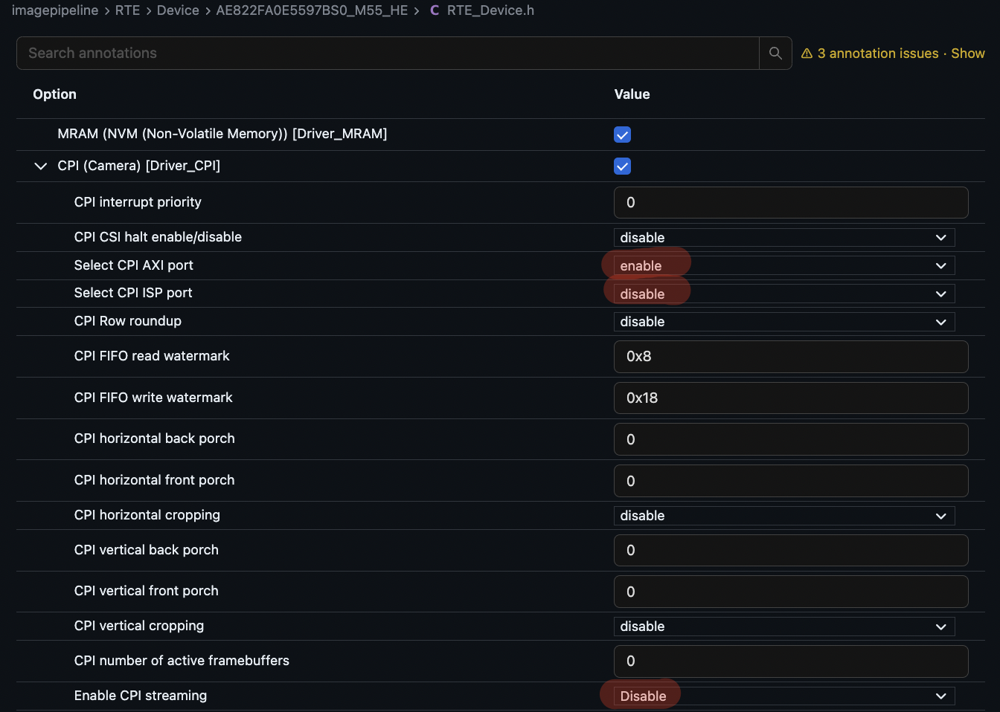
   > **Why?** The CPI has two outputs. The **AXI port** writes frames directly to memory, and the **ISP port** passes them to the Image Signal Processor. There is no ISP in this section, so the raw frame goes straight to memory. **Streaming** is disabled so that each capture call takes exactly one frame. With streaming enabled, the CPI would keep overwriting the buffer while you inspect it in the debugger.
7. Enable and expand **MIPI_CSI2 (mipi csi2) [Driver_MIPI_CSI2]**, then configure:
   | Setting | Value |
    | --- | --- |
    | Select CSI2 DPHY backend | CSI2 RX DPHY |
    | Select IPI mode | Camera mode |
    | Select CSI2 Data type to overwrite | RAW8 |

    Inside the **MIPI_CSI2** group, enable and expand **OV5675_MIPI [Driver_OV5675_MIPI]**, then configure:
    | Setting | Value |
    | --- | --- |
    | Select camera OV5675 frequency | `450000000` (450 MHz) |
    | Select OV5675 override CPI color mode | 1 |
    | Select OV5675 image configuration | 1296x972_RAW10 |

    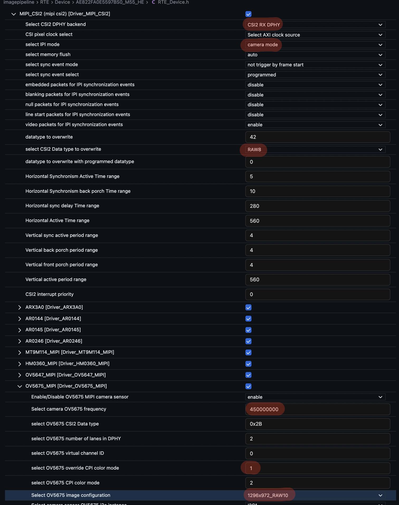
   > **Why?**
   >
   > - **CSI2 RX DPHY:** The camera connector on the AppKit is wired to the dedicated CSI-2 receive PHY. The alternative reuses the display (DSI) PHY as a receiver, which only applies to boards wired that way.
   > - **Camera mode:** The CSI-2 receiver takes its line and frame timing from the incoming sensor stream instead of from timing values you program yourself.
   > - **RAW8:** Each pixel is stored as one byte. That makes the dump easy to view as an 8-bit grayscale image. In Section 2 you switch to RAW10 so that the ISP receives the sensor's full 10-bit data.
   > - **1296x972_RAW10:** This is the OV5675's 2x2 binned mode, a quarter of the full 2592x1944 resolution. It needs much less bandwidth and memory while still producing a good image.
   > - **450 MHz:** This is the MIPI link rate the sensor is configured to transmit at in this mode. The receiver must use the same rate as the sensor.
8. Enable **I2C (Inter Integrated Circuit) [Driver_I2C1]**.
   > **Why?** The OV5675 control interface is wired to the I2C1 instance on the AppKit camera connector. The sensor driver uses it to write the sensor's registers, for example to select the resolution and start streaming.
9. Close `RTE_Device.h`. Changes are written to the file as you make them, so there is nothing to save.

### Build and run

10. In the **CMSIS** view, expand the **App** group and open `main.c`. Scroll through the file and confirm that the camera-related code is now active (no longer greyed out).

    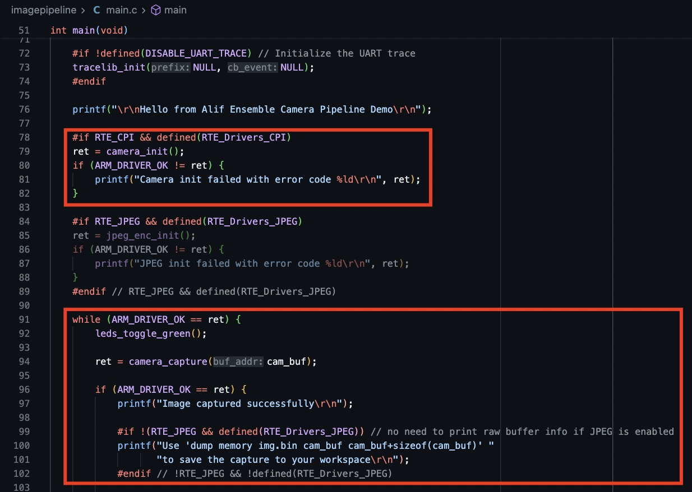
    > **Why?** Each driver you enable in `RTE_Device.h` defines a matching macro, for example `RTE_CPI`. The application code uses `#if` checks on these macros, so code for drivers that are not enabled is excluded from the build and greyed out in the editor.
11. Build the application. The build should finish with no warnings or errors.
12. Press the **Reset** button on the board so the SoC starts from a clean state.
    > **Why?** The camera sensor and the MIPI interface keep their state from the previous run. A hardware reset ensures that they start from a known state before the new firmware configures them.
13. Start the debug session and resume execution. Check the serial terminal output to confirm that the application is running correctly.

    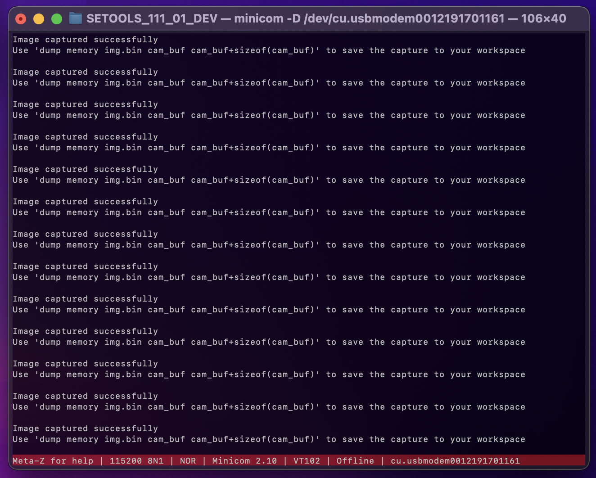

### Capture the image

14. Set a breakpoint on line **91** of `main.c` by clicking just to the left of the line number.
15. Execution pauses when the SoC reaches that line.

    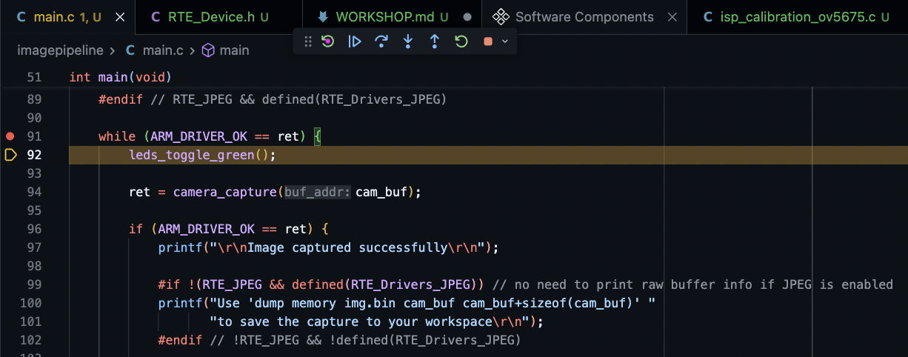
16. Open the **Debug Console** view in the lower panel.
17. At the prompt at the bottom of the console, run:
    ```gdb
      dump memory img.bin cam_buf cam_buf+sizeof(cam_buf)
    ```

   This saves the contents of the camera buffer to `img.bin` in the workspace folder.

   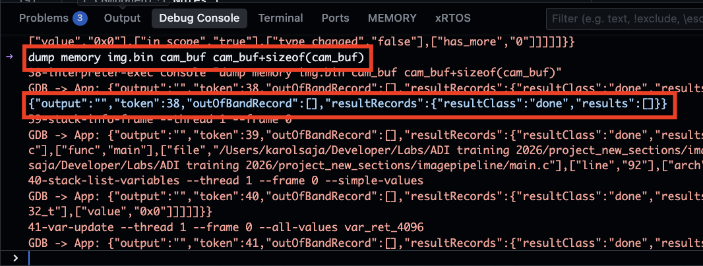

    > **Why?** `cam_buf` resolves to the start of the camera buffer in SRAM. `sizeof(cam_buf)` makes the debugger calculate the buffer size, so the command copies exactly one frame.

### View the image

18. In a web browser, open RawPixels: <https://web.archive.org/web/20230918090107/https://rawpixels.net/>
19. Click **Choose file** and select the `img.bin` file you just captured.
20. Set **Width** and **Height** to `1296` and `972` respectively and **Predefined format** to **Grayscale 8bit**.

    > **Note:** Grayscale is not an exact rendering of a raw Bayer image, but it is a close approximation that shows the important detail. Each pixel records only one color (red, green, or blue) in a repeating 2x2 pattern, which is why you may see a fine grid texture. Color reconstruction is covered in the next section.
21. Return to VS Code and press **Stop** to end the debug session.
22. Remove the breakpoint.

---

## Section 2 – Processing the Image with the ISP

In this section you route the camera data through the Image Signal Processor (ISP), which converts the raw Bayer data into a color image in NV12 (YUV 4:2:0 semi-planar) format.

> **Catching up?** This section continues from Section 1. If you are behind, run:
>
> ```sh
> git checkout section2
> ```

### Add and configure the ISP

1. In the **CMSIS** tab, open the **Manage Software Components** view.
2. Select the following component and press **Save**:
   | Component | Notes |
    | --- | --- |
    | `Device → SOC Peripherals → ISP` | Image Signal Processor |

    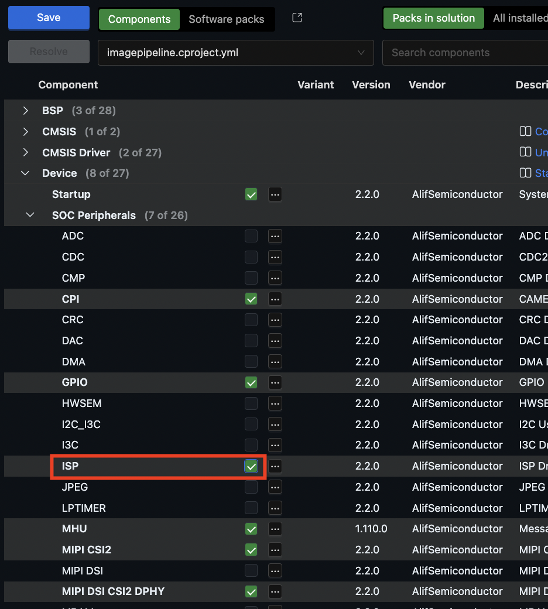
3. In the **CMSIS** tab, open **Components** → `AlifSemiconductor::Device:Startup` → `RTE_Device.h`.
4. Enable and expand **ISP (ISP) [Driver_ISP]**, then configure:
   | Setting | Value |
    | --- | --- |
    | ISP Output Format | NV12 (YUV420 semi-planar) |

    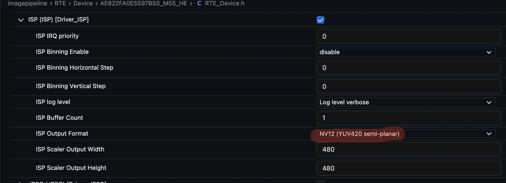
   > **Why?** NV12 stores full-resolution brightness (Y) followed by color (UV) at a quarter of that resolution. It uses half the memory of RGB888, and it is a 4:2:0 format, which is the input format the JPEG encoder expects in Section 3. The ISP output can therefore go straight to the encoder without a conversion step.
5. Expand the **CPI** section and change:
   | Setting | Value |
    | --- | --- |
    | Select CPI AXI port | Disable |
    | Select CPI ISP port | Enable |
   > **Why?** Frames now go to the ISP instead of directly to memory. The raw frame buffer is no longer needed, which frees a large block of SRAM. The project checks this setting: if the AXI port is left enabled while the ISP is in use, the build stops with an error.
6. Expand **MIPI_CSI2** and change:
   | Setting | Value |
    | --- | --- |
    | Select CSI2 Data type to overwrite | RAW10 |

    Inside the **MIPI_CSI2** group, expand **OV5675_MIPI [Driver_OV5675_MIPI]**, and change the following settings:
    | Setting | Value |
    | --- | --- |
    | Select OV5675 override CPI color mode | 0 |

   > **Why?** The ISP processes the sensor's full 10-bit data. The two extra bits give it more detail in dark and bright areas, which leads to better exposure, white balance, and color reproduction than 8-bit input.
7. Go to File → Save and then open `main.c` and confirm that the ISP-specific code is now active.

### Build, run, and capture

8. Build the application, start the debug session, and resume the execution.
9. Check the serial terminal output to confirm that the application is running. Output should be the same as in the previous section.
10. Set a breakpoint on line **91** of `main.c`, right after the code loops around after camera capture and ISP processing.
11. Execution will pause at the breakpoint.
12. Open the **Debug Console** and run the following command to capture the ISP output:
    ```gdb
      dump memory img.bin cam_buf cam_buf+sizeof(cam_buf)
    ```

### View the image

13. Switch to the browser tab with RawPixels and refresh the page. If you closed it, open it again: <https://web.archive.org/web/20230918090107/https://rawpixels.net/>
14. Click **Choose file** and select the updated `img.bin`.
15. Apply the following settings to render the image correctly:
    | Setting | Value |
    | --- | --- |
    | Width | `480` |
    | Height | `480` |
    | Predefined format | YUV 420 SP (NV12) |
    | Pixel format | YUV |
16. Return to VS Code and press **Stop** to end the debug session.
17. Remove the breakpoint.

---

## Section 3 – JPEG Encoding

In this section you add the hardware JPEG encoder, which compresses the ISP output into a standard JPEG file.

> **Catching up?** This section continues from Section 2. If you are behind, run:
>
> ```sh
> git checkout section3
> ```

### Add and configure the JPEG encoder

1. In the **CMSIS** tab, open the **Manage Software Components** view.
2. Select the following component and press **Save**:
   | Component | Notes |
    | --- | --- |
    | `Device → SOC Peripherals → JPEG` | Hardware JPEG encoder |

    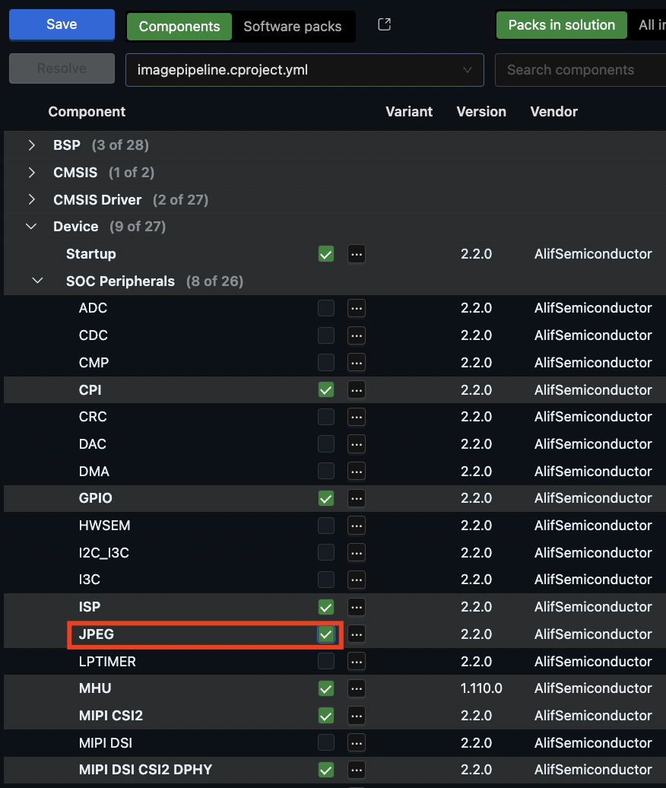
3. In the **CMSIS** tab, open **Components** → `AlifSemiconductor::Device:Startup` → `RTE_Device.h`.
4. Enable **JPEG (JPEG) [Driver_JPEG]**.

   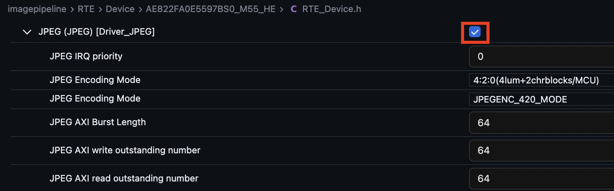
   > **Why?** The default settings are kept. The encoder's only encoding mode is 4:2:0, which matches the NV12 output you configured on the ISP in Section 2.
5. Open `main.c` and confirm that the JPEG-specific code is now active.

### Build, run, and capture

6. Build the application and start the debug session.
7. Check the serial terminal output to confirm that the application is running.

   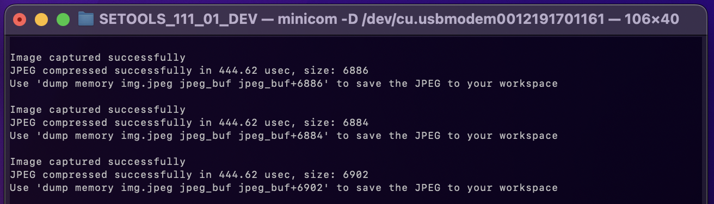
8. Set a breakpoint on line **92** of `main.c`, right after the code loops around after JPEG encoder has processed the image.
9. Execution will pause at the breakpoint.
10. Open the **Debug Console** and run the following command to capture the encoded image:
    ```gdb
      dump memory img.jpeg jpeg_buf jpeg_buf+<size>
    ```

### View the image

11. JPEG images can be opened almost anywhere, including directly in VS Code.
12. Open the **Explorer** tab on the left and double-click `img.jpeg` to view it.

    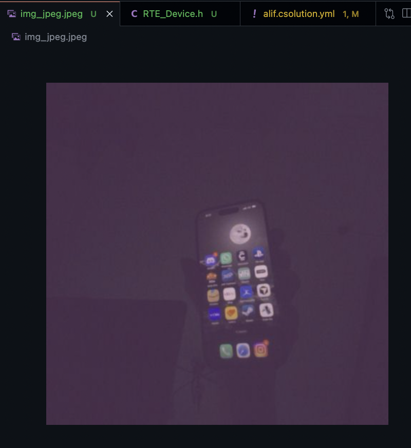
13. Press **Stop** to end the debug session.

---

## Congratulations!

You have completed the workshop. You built a full image pipeline on the Alif Ensemble E8: capturing raw sensor data over MIPI CSI-2, converting it to color with the ISP, and compressing it with the hardware JPEG encoder.
